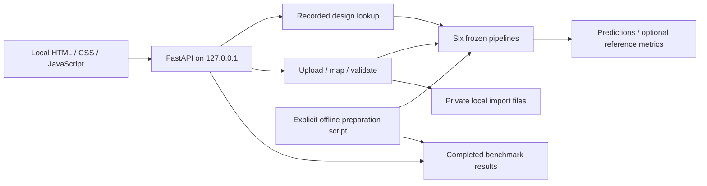

# Research and architecture decisions

The requirement is a live local AI web application for a classroom assessment, grounded in the provided notebook and paper. The selected scope is a custom interface, guided study configurations, research results, and external testing of compatible building datasets. This report records the decisions behind the implementation.

## Application architecture

| Option compared | Strength for this project | Cost / limitation | Decision |
|---|---|---|---|
| Streamlit | Python-first controls, model caching, built-in testing | Less control over the custom architectural interface requested | Considered, not selected |
| React plus Python API | Component ecosystem and frontend state tooling | Introduces a build tool and dependencies for four small views | Considered, not selected |
| FastAPI plus native HTML/CSS/JS | Direct Python inference, custom interface, one same-origin local server | UI state and SVG rendering are implemented explicitly | Selected |

These trade-offs are specific to a small local app, not universal framework rankings. FastAPI documents [static serving](https://fastapi.tiangolo.com/tutorial/static-files/), [shared model startup](https://fastapi.tiangolo.com/advanced/events/), [file uploads](https://fastapi.tiangolo.com/tutorial/request-files/), and [HTTPX/pytest testing](https://fastapi.tiangolo.com/tutorial/testing/). Streamlit provides [model-resource caching](https://docs.streamlit.io/develop/concepts/architecture/caching). React’s from-scratch approach begins with a [build tool](https://react.dev/learn/build-a-react-app-from-scratch).

The resulting architecture has a browser interface, a small local API, six frozen model pipelines, and file-backed benchmark/import storage. A database and separate frontend service would not improve the current workflows enough to justify their operational cost. Batch prediction is bounded to 10,000 records and does not need a background queue.

## ML lifecycle and scientific boundaries

The training cell is reused rather than reimplemented. The only change inside that cell anchors its output folder beside the source. A normal executable entry point calls it with the original thread limit. Hyperparameter grids, folds, split seed, preprocessing, scoring, and selection are unchanged.

The core environment reproduces the notebook’s saved versions: Python 3.12, NumPy 2.1.3, SciPy 1.16.3, pandas 2.2.3, and scikit-learn 1.6.1. Complete dependencies are locked. Scikit-learn advises using matching versions for [persisted models](https://scikit-learn.org/1.6/model_persistence.html). The app reads only its prepared model files, never model uploads.

There are three distinct evidence sources: live development-model predictions, saved outer-fold predictions, and original simulated responses. Their labels remain explicit. External uploads use frozen models and are separate from both benchmark experiments. Matching a training configuration is disclosed but does not by itself prove a measured observation is duplicated.

The [UCI repository](https://archive.ics.uci.edu/dataset/242/energy%2Befficiency) documents 768 configurations from 12 shapes and eight predictors. The [original paper](https://doi.org/10.1016/j.enbuild.2012.03.003), particularly its data section, describes the simulation setting, glazing fractions of floor area, and distribution scenarios. It does not make the simulation representative of Philippine field conditions. Response units are not supplied in the repository variable table; the app therefore does not invent a kWh label or annual bill interpretation.

External numerical metrics require the user to state reference definitions/units and confirm comparability. This declaration is retained in exports and is not represented as independent scientific verification. Without it, batch predictions remain available. Missing references affect only their target’s metric sample. Constant references or one-record samples produce unavailable R² rather than a misleading finite score. [R² definition and edge cases](https://scikit-learn.org/1.6/modules/generated/sklearn.metrics.r2_score.html)

## Interface design

The visual direction is an architectural drawing desk: a warm neutral surface, restrained teal and terracotta, thin drafting rules, generous grouping, and a schematic envelope. The schematic is explicitly illustrative; its glazing layer responds to the selected glazing input and it is not claimed to reconstruct any of the 12 buildings. IBM Plex Sans handles prose and controls; Plex Mono makes numeric comparisons easy to scan. Fonts are served locally with their [Open Font License](https://github.com/IBM/plex).

Native selects, buttons, details elements, labels, and navigation links supply standard keyboard behavior. Errors appear alongside the affected action; pending or changed inputs hide old prediction output. Tables accompany SVG charts. A narrow-screen layout stacks forms and results and contains wide tables within scrollable regions. The [W3C forms tutorial](https://www.w3.org/WAI/tutorials/forms/) supports explicit labels, instructions, and error feedback.

The UI refinement keeps the drawing-desk direction while making the working controls easier to find: compact headings, persistent navigation, readable tables, a three-step dataset guide, and a separate optional-reference section. Its design feasibility assessment is 14: impact 4, context fit 5, feasibility 4, performance 4, minus consistency risk 3.

Motion serves navigation and state feedback. Native [Web Animations](https://developer.mozilla.org/en-US/docs/Web/API/Element/animate) provide 200-ms opacity/transform entrances with 30-ms panel staggering; CSS handles 120-ms press feedback and the glazing opacity transition. Keyboard actions remain immediate. Existing animations are cancelled on navigation, keyboard input, hidden pages, or a change to [reduced-motion preferences](https://developer.mozilla.org/en-US/docs/Web/CSS/@media/prefers-reduced-motion). There are no perpetual decorative loops, animated prediction counters, or added animation dependencies.

## Import boundary and persistence

CSV/XLSX files are parsed as data, not executable content. Upload and expanded-workbook size limits, row/column caps, defused XML parsing, and unique headers bound the parsing work. File-system names are generated IDs; uploaded names are display metadata. Original files are never publicly mounted. Checksums detect changed originals, while the latest report retains its source hash, mappings, and model provenance.

Validation rejects missing/nonfinite values and unsupported categories instead of allowing one-hot encoding to silently accept unfamiliar codes. Tree inputs must fit float32. Novel continuous values and geometry generate notices rather than blocking a bounded external experiment. Rejected rows remain traceable by source row. No automatic imputation, deduplication, category recoding, or unit conversion occurs.

Storage uses ordinary private folders and JSON/CSV files because each import has one original and a latest evaluation. The application renders imported labels as text nodes. Exports contain canonical numeric columns and fixed status/issue fields. Loopback binding, trusted-host checks, same-origin writes, and a self-only Content Security Policy fit the local deployment. No accounts or public hosting are implied by this design.

Temporary online sharing is opt-in: `ENERGY_PUBLIC_HOST` allows exactly one additional hostname and its HTTPS origin while retaining same-host writes. A separate loopback instance and import folder serve the temporary Cloudflare tunnel. The public library is shared by visitors to that link; it is separate from local imports. The tunnel is not permanent hosting.

## Verification and delivery

API checks cover actual pipeline calls, direct-call parity, benchmark metric recalculation, frozen-model behavior, upload boundaries, column mappings, comparability gating, reference edge cases, private storage, source integrity, and persistence. Browser checks cover all four views, CSV/XLSX workflows, exports, saved evaluations, explicit invalid-row handling, failure recovery, narrow-screen overflow, and keyboard entry. External browser requests are blocked during the workflow test. Automated axe-core scans cover the four desktop views; this is useful test evidence, not a claim of full accessibility certification.

The source package includes the model bundle, original notebook, locked environment, research outputs, setup/run scripts, and demonstration guide. It excludes private imports and machine-specific environments. Initial dependency installation needs internet; prepared inference and dataset testing do not.
